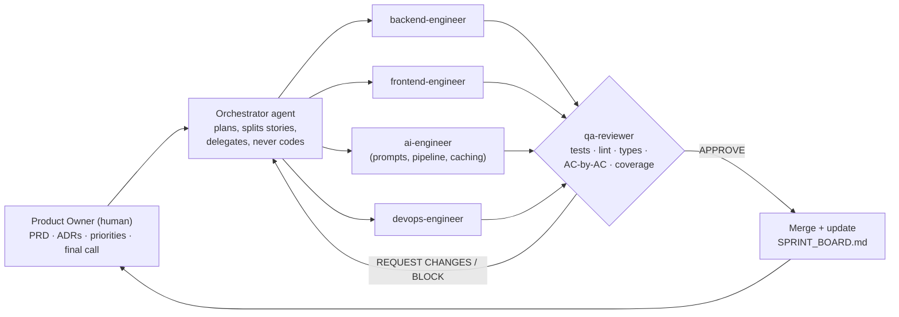

# PhishForge

**An AI studio that turns a scenario brief into a ready-to-send phishing-simulation email, complete with AI-generated imagery, for authorized security-awareness audits. It was built almost entirely by a team of AI agents, run by a Product Owner who never wrote the feature code.**

> **Built by Ishaan Karnik, an AI-enabled Product Owner.**
> This repo has two things to look at: the **product** (a working, deployed, multi-stage LLM pipeline) and the **process** (an agentic delivery system with specialist agents, quality gates and a paper trail). The process is the more interesting half.

---

## Why this repo exists

Most "built with AI" projects show the output. This one shows the **operating model**:

- A **PRD, ADRs and a sprint board** written by the human Product Owner.
- An **orchestrator agent** that plans, delegates, and *never implements directly*.
- **Specialist subagents** (backend, frontend, AI/prompt engineer, DevOps), each limited to its own part of the codebase.
- An independent **`qa-reviewer` agent with merge-blocking authority**. It runs the tests, lints, type-checks and checks every acceptance criterion, then writes a verdict file.
- **65+ review artifacts** in [`reviews/`](reviews/) that you can open and read. Several of them are `REQUEST CHANGES`, where the reviewer caught real defects.

If you're hiring for AI-assisted delivery, product ownership of agent teams, or AI-native engineering process, start with [`docs/AGENTIC_METHODOLOGY.md`](docs/AGENTIC_METHODOLOGY.md).

---

## The methodology at a glance



| Principle | How it's enforced here |
|---|---|
| **Separation of duties** | The author of code is never its reviewer. `qa-reviewer` is read-only on code and can't "just fix it". |
| **Scoped agents** | Each agent's definition in [`.claude/agents/`](.claude/agents/) lists what it may touch. Cross-scope work is split into separate stories. |
| **Spec before code** | A PRD with numbered acceptance criteria, and a per-story review that is graded **AC-by-AC**. |
| **A merge gate with teeth** | Nothing merges without an `APPROVE` verdict in `reviews/STORY-X-review.md`. |
| **Definition of Done as a checklist** | 80% coverage on new code, `mypy --strict`, TypeScript strict, ruff clean, Alembic migration with a tested downgrade for every schema change. |
| **Cost and API hygiene** | The default test run is offline, with the LLM mocked. Real-API tests are opt-in (`-m integration`). Prompt caching is *verified* on every LLM call. |
| **Product Owner stays in control** | The agents are told: "if unsure, stop and ask the human. Never guess at requirements." |
| **Living audit trail** | One status tracker ([`docs/SPRINT_BOARD.md`](docs/SPRINT_BOARD.md)), 31 recorded decisions ([`docs/ADR.md`](docs/ADR.md)), and an AC-by-AC implementation audit ([`docs/PRD_AUDIT.md`](docs/PRD_AUDIT.md)). |

The full contract the agents run under is in [`CLAUDE.md`](CLAUDE.md), [`.claude/claude-code-workflow.md`](.claude/claude-code-workflow.md) and the slash commands in [`.claude/commands/`](.claude/commands/) (`/start-story`, `/review-story`, `/merge-story`).

### By the numbers

| | |
|---|---|
| Commits | ~300 |
| Stories delivered | 46 (mailer, 9 sprints) + ~17 (AI asset library) + 13 (phishing-sim pivot, 3 sprints) + a change-request sprint, all through the review gate |
| Review verdicts on file | 60+ `APPROVE`, plus several `REQUEST CHANGES` rounds |
| Acceptance-criteria audit | 150 ✅ / 6 ⚠️ / 0 ❌ across 156 ACs ([`PRD_AUDIT.md`](docs/PRD_AUDIT.md)) |
| Backend tests | 772 passing in the latest recorded full run ([BUG-7 review](reviews/BUG-7-review.md)) |
| Frontend tests | 500+ (Vitest) plus Playwright E2E |
| Prompt caching | Verified in a live run: second call `cache_read_input_tokens = 3268` |

### The reviewer catches real problems

These are from the artifacts in `reviews/`, not invented examples:

- **[BUG-7](reviews/BUG-7-review.md)**: The refiner LLM was corrupting image URLs when it rewrote a template. The fix tokenizes URLs before the call and restores them afterwards. Round 1 got `REQUEST CHANGES` for a single lint failure (ruff E501). Round 2 got `APPROVE` after re-verification.
- **[STORY-4.5](reviews/STORY-4.5-review.md)**: A share-link "suggestion" chat role leaked into the LLM's chat history, which Anthropic would have rejected at runtime. The reviewer wrote the fix constraint and **mutation-tested the regression test**. They removed the filter, watched the test fail, then restored it.
- **[STORY-AP3.1](reviews/STORY-AP3.1-review.md)**: Blocked on a format-check regression *and* an under-tested critical code path (vision sample-email handling) that fell below the 80% coverage bar.
- **[STORY-A3.1](reviews/STORY-A3.1-review.md)**: All acceptance criteria were met, but the frontend test suite exited non-zero because jsdom doesn't implement `scrollIntoView`. It was blocked until fixed.

---

## The product

**Problem.** Security firms that run authorized anti-phishing audits hand-craft simulation emails one at a time. That's slow, inconsistent, and hard to scale across clients.

**Solution.** PhishForge turns a structured *pretext brief* (who the lure impersonates, the scenario, urgency, the call to action) into a polished, email-safe simulation template. You can then refine it in a two-pane visual editor or by chatting with it.

**What it does**

- **Pretext brief form** with impersonation presets, optional **sample-email upload** (the model uses real lures as visual references), and a visible authorization boundary.
- **Multi-stage LLM pipeline** (generate → validate/retry → refine → export) that turns the brief into **MJML**, which compiles to email-safe HTML. Claude Sonnet generates and Claude Haiku refines. An MJML validator and retry loop guard the output, so the model never emits raw HTML.
- **Two-pane editor** (GrapesJS plus live preview) with chat-based refinement, direct text edits, version history and export.
- **AI image studio and asset library** (OpenAI GPT Image 2), covered in the next section. This is the largest capability added on top of the base mailer.
- **Observability**: per-call token and cost tracking, with the cache savings shown.

**Scope boundary (by design).** PhishForge generates *templates only*. It does not send email, manage target lists, host landing pages or track clicks and credentials. See [Responsible use](#responsible-use).

### Image generation: an asset library built beyond the base mailer

The original mailer could only *upload* images. I extended it with a full AI image workflow, specified in [`docs/PRD-asset-library.md`](docs/PRD-asset-library.md), prompt-engineered in [`docs/GPT_IMAGE_PROMPT_GUIDE.md`](docs/GPT_IMAGE_PROMPT_GUIDE.md), and delivered as ~17 reviewed stories (A1.x to A5.x):

- **Generate** from a text prompt with style presets, banner dimensions and a brand-neutral base prompt, via the GPT Image 2 API.
- **Iterate**: regenerate (new seed), **refine** with a new instruction, or edit the original prompt and re-run. Every change is kept as a **version**, with a timeline and "set as primary".
- **Use as reference**: feed an existing image back in (the `images.edit` path) to create a new asset inspired by it.
- **Mask editor**: paint a region and regenerate only that part (inpainting).
- **Library**: shared, searchable, tagged assets with bulk tagging, soft-delete and a detail page.
- **Wired into the email workflow**: an asset picker in the brief form, "swap from library" inside the editor, inline generation, and **chat-based asset references** ("use the hero image from my library").
- **Cost tracking** per image alongside per-call LLM cost.

Design choice worth noting: this is not a bolt-on image generator. The key product insight (PRD §1) is that image-heavy emails need the visual to *be* the content, so generation is integrated into the same flow as the email pipeline.

### Architecture

```
React 18 + TS + Vite  ──►  FastAPI (async)  ──►  MySQL (SQLAlchemy 2 + Alembic)
   GrapesJS editor            │
   Tailwind design system     ├─► LLM pipeline: brief → generate → compose → validate/retry
                              │       Claude Sonnet (generate) / Haiku (refine), prompt caching
                              ├─► MJML subprocess (pinned 5.1.0) → email-safe HTML
                              └─► OpenAI GPT Image → asset library
```

Deeper dives: [`docs/SYSTEM_OVERVIEW.md`](docs/SYSTEM_OVERVIEW.md) · [`docs/legacy-architecture.md`](docs/legacy-architecture.md) · [`docs/MJML_CONTRACT.md`](docs/MJML_CONTRACT.md) · [`docs/ai-pipeline.html`](docs/ai-pipeline.html)

**Stack:** Python 3.12 · FastAPI · SQLAlchemy 2 (async) · Alembic · Anthropic SDK + Instructor (structured output) · MJML · React 18 · TypeScript (strict) · Vite · Tailwind · GrapesJS · Vitest · Playwright · Docker Compose

---

## Repo tour

| Path | What's in it |
|---|---|
| [`CLAUDE.md`](CLAUDE.md) | The agent operating contract: roles, rules, git workflow, merge gate |
| [`.claude/agents/`](.claude/agents/) | Four specialist agents plus the qa-reviewer, with their scopes |
| [`.claude/commands/`](.claude/commands/) | `/start-story`, `/review-story`, `/merge-story` |
| [`docs/PRD-anti-phishing.md`](docs/PRD-anti-phishing.md) | The PRD for the pivot, written by the PO |
| [`docs/ADR.md`](docs/ADR.md) | Architecture decision records |
| [`docs/SPRINT_BOARD.md`](docs/SPRINT_BOARD.md) | The authoritative status tracker, updated at every transition |
| [`docs/CR-001-brief-form-rationalization.md`](docs/CR-001-brief-form-rationalization.md) | A change request: plan, redline, then implement |
| [`reviews/`](reviews/) | **The qa-reviewer's verdicts**, one per story |
| [`PRODUCT.md`](PRODUCT.md) / [`DESIGN.md`](DESIGN.md) | Product principles and design-system spec |
| `backend/` · `frontend/` | The application |
| `deploy*/` | Docker Compose deployment and runbook |

---

## Run it locally

Needs Python 3.12, Node 20+, pnpm, MySQL 8, and your own API keys. **No keys are included in this repo.**

```bash
# backend
cd backend
cp .env.example .env          # add your own ANTHROPIC_API_KEY, SECRET_KEY, DATABASE_URL
uv venv && uv pip install -e ".[dev]"
npm install                   # installs the pinned MJML toolchain
alembic upgrade head
uvicorn app.main:app --reload --port 8000

# frontend
cd frontend && pnpm install && pnpm dev   # http://localhost:5173

# tests (fast, offline, LLM mocked)
cd backend && pytest
```

Step-by-step: [`docs/DEV_SETUP.md`](docs/DEV_SETUP.md). Docker deploy: [`deploy-generic-v2/`](deploy-generic-v2/) and [`docs/DEPLOYMENT.md`](docs/DEPLOYMENT.md). Seed demo users are documented there.

---

## Responsible use

PhishForge is for **authorized, consented** security-awareness testing (the same model as commercial phishing-simulation platforms). Read [`SECURITY.md`](SECURITY.md). Don't use it to deceive people who haven't agreed to be tested. The generation prompts frame every output as an authorized simulation, and the scope deliberately excludes sending, targeting and credential capture.

## Provenance

PhishForge is a **fork of an AI email-studio ("mailer") POC** that generated marketing emails from a brief. I forked it for a different purpose, anti-phishing audit simulations, and extended it substantially:

1. **Pivot**: new PRD, a pretext-based brief form, impersonation presets, rewritten generation and refinement prompts, and an authorized-simulation framing (Sprints AP-0 to AP-3, plus [CR-001](docs/CR-001-brief-form-rationalization.md)).
2. **AI image studio**: the asset library described above, which the base mailer did not have.

The `docs/legacy-*` files describe the original marketing use case. For this public release, the demo brand used throughout the original POC (a real bank's name, logos and domains) was replaced with a fictional "Acme Bank", legacy screenshots showing it were removed, and internal infrastructure details were redacted.

## License

[MIT](LICENSE) © 2026 Ishaan Karnik
