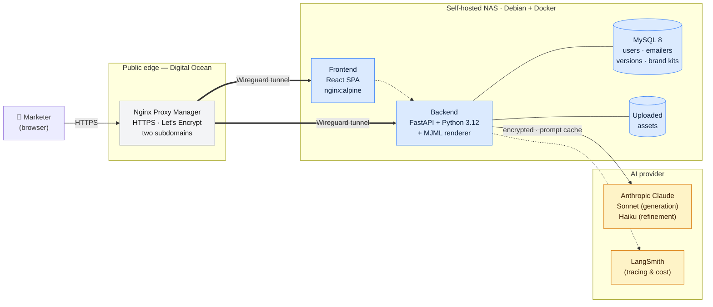
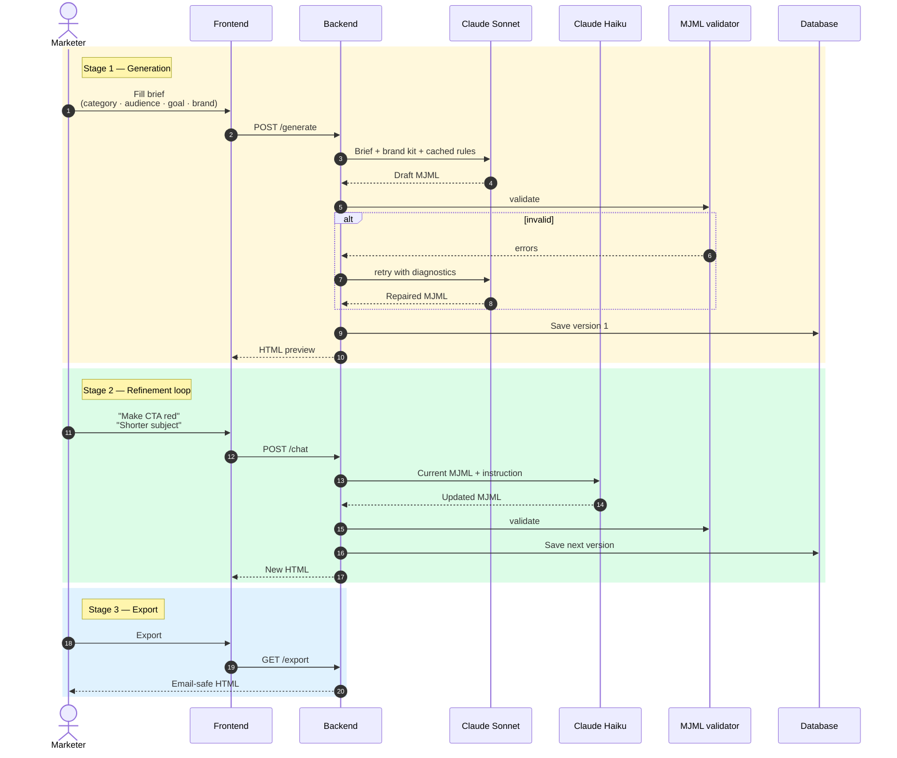

# Acme Emailer Studio — System Overview

A short, executive-level walkthrough of what was built, how it runs, and what it does for the marketing team.

---

## 1. Application architecture

Self-hosted, single-VM deploy. A React SPA in the browser talks to a FastAPI backend through Nginx Proxy Manager (TLS + routing), which sits on a Digital Ocean droplet and tunnels into our NAS over Wireguard. The backend persists everything in MySQL and shells out to the Anthropic API for AI work. No third-party SaaS for data — every email draft lives on infrastructure we control.

**Highlights**
- One `docker compose up --build -d` brings up the entire stack (frontend, backend, database) from source — no container registry.
- Database is internal-only on a private docker network. Never exposed to the internet.
- TLS, certificate renewal, and rate-of-traffic shaping are handled by NPM at the edge.

---

## 2. AI pipeline

Three stages, two models, one validator. Generation uses **Claude Sonnet** (high quality, brand-aware). Refinement uses **Claude Haiku** (cheap, fast, conversational). A strict MJML validator sits between the LLM and storage so we never persist a broken template — the system auto-retries with feedback if the model produces invalid markup.

Prompt caching is on for every call: the brand kit + system prompt are reused across calls, so we pay full price only on the first request.

**Why this matters**
- **Cost is visible per emailer.** Every LLM call is logged with input/output tokens, latency, and cost. We can answer "what did this campaign cost to draft?" in seconds.
- **Brand drift is structural, not aspirational.** The brand kit is injected into the prompt for every call. Changing brand kits at runtime regenerates with the new identity.
- **Bad output never persists.** A model hallucinating broken markup triggers an automatic retry with diagnostics — by the time the marketer sees the canvas, it's a clean MJML tree.
- **Refinement is ~20× cheaper than regeneration.** Haiku turns multi-second tweak loops into sub-second responses.

---

## 3. Features

What the marketing team actually sees and does. Every block below is a shipped feature, not a roadmap item.

**Numbers that the boss will ask about**
- **End-to-end speed:** Brief → exportable HTML in **65–105 s** (warm cache). Manual baseline was a half-day.
- **Refinement turns to ship-ready:** **median 2** (target ≤ 5).
- **Email-client compatibility:** **4 / 4** clean across Gmail, Outlook, Apple Mail, mobile webmail (MJML guarantees this).
- **Cache hit rate:** ~80 % on the second call onward (system prompt + brand kit are stable across a session).
- **Test coverage:** 452 backend tests + 294 frontend tests + 8 docker e2e tests, all green on every merge.

---

## How to view these diagrams

The diagrams above are written in [Mermaid](https://mermaid.js.org). They render automatically when this file is opened on:
- GitHub / GitLab / Bitbucket
- Notion (paste into a `mermaid` code block)
- VS Code with the Mermaid preview extension
- [mermaid.live](https://mermaid.live) — paste each block to get a downloadable PNG / SVG

For slide decks, screenshot the rendered output or export PNG from `mermaid.live`.
